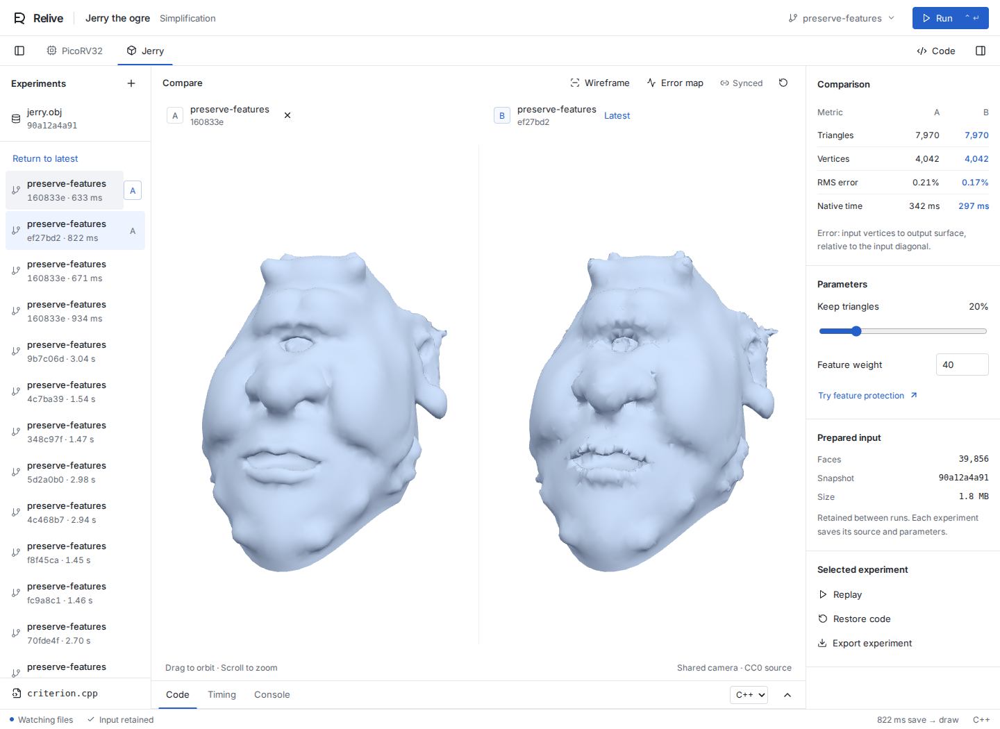
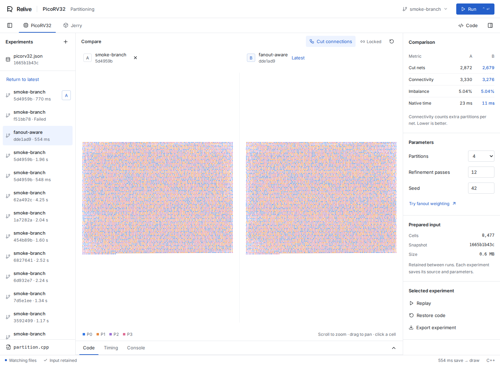

# Relive

An interactive workbench for native algorithms. Edit C++ or Rust in your usual editor, save, and compare the new result on the same prepared data.

Relive recompiles the actual native code. A prepared process holds the input; replaceable workers run each version. A failed build or a native crash leaves the previous result and prepared data available.

[Recorded demos and measured latency](https://kennethassogba.github.io/relive/) · [Two-minute demo](docs/demo.md) · [Architecture](docs/architecture.md)



## Try it

The prototype targets **Linux x86-64**, including WSL2. It needs Python 3.12+, Node 22.12+, a C++17 compiler, Eigen headers and Rust. The tested versions and measured timings are in [the benchmark report](docs/benchmark.md).

```bash
# Ubuntu / Debian prerequisites
sudo apt install g++ libeigen3-dev python3-venv
# Install Node and Rust if needed: https://nodejs.org/ and https://rustup.rs/

git clone https://github.com/kennethassogba/relive.git
cd relive
npm run setup
npm run dev
```

Open **http://127.0.0.1:7331** and click **Prepare & run**. Setup downloads pinned libigl source, restores the bundled datasets, compiles the stable geometry engine once, and builds the interface. Subsequent development runs use local files and do not require a network connection.

The bundled inputs total about 1 MiB compressed. Normal setup does not run Yosys. Build and experiment jobs run serially; the default worker and compiler virtual-memory limits are 768 MiB and 1536 MiB. The browser has its own memory use. See [resource limits](docs/architecture.md#resource-limits).

## Workspace

The comparison occupies the central canvas. Experiments are on the left, metrics and parameters on the right. The bottom dock contains CodeMirror, timing details and compiler output. Collapse either side panel when you need more canvas space.

- **Ctrl/Cmd+Enter** runs the current algorithm. **Ctrl/Cmd+S** saves the source editor.
- Mesh views share orbit and zoom controls; netlist views share pan and zoom.
- Arrow keys, plus/minus and zero navigate or reset the focused canvas.
- Tabs and branch dialogs support keyboard navigation.

The interface follows [VS Code view/panel guidance](https://code.visualstudio.com/api/ux-guidelines/views), [Linear’s navigation hierarchy](https://linear.app/now/behind-the-latest-design-refresh), and [WAI-ARIA tab patterns](https://www.w3.org/WAI/ARIA/apg/patterns/tabs/). The component and interaction contract is in [DESIGN.md](DESIGN.md).

## Two native examples

### Partition a RISC-V processor

PicoRV32 is an open-source CPU, synthesized with Yosys into 8,477 cells. The demo constructs a hypergraph from shared signal bits, retaining nets with at least two incident cells. Edit [`examples/netlist/partition.cpp`](examples/netlist/partition.cpp) and save. The new library runs a balanced local-refinement partitioner against the same incidence arrays and layout.

Inspect partition colors, cut connections, cut-net count, connectivity (`λ − 1`), imbalance and runtime. **Try fanout weighting** makes a real edit to `FANOUT_EXPONENT`, branches from the current experiment and pins the previous result for comparison.



The layout is a deterministic connectivity ordering, not a physical floorplan. This editable heuristic is not Mt-KaHyPar, and no performance or quality claim against Mt-KaHyPar is made.

### Simplify Jerry the ogre

The original CC0 model by Keenan Crane has 19,985 vertices and 39,856 triangles. libigl contracts edges until the target triangle count is reached or no valid collapses remain. Boundary vertices are protected.

Edit [`examples/mesh/criterion.cpp`](examples/mesh/criterion.cpp), or choose **Rust** and edit [`examples/mesh/criterion.rs`](examples/mesh/criterion.rs). Both compile to native shared libraries with the same edge-cost ABI. **Try feature protection** modifies the compiled criterion rather than applying a visual filter.

The views share a camera. Toggle wireframe or the geometric error map. Error is the distance from each **input vertex** to the simplified surface, normalized by the input bounding-box diagonal. It is a directed, vertex-sampled measure, not a symmetric Hausdorff distance or a guarantee on all surface points. Both error maps use the same fixed color scale.

## Branch, compare, replay

1. Run an experiment. Its code, parameters and prepared snapshot are saved.
2. Click **A** beside a successful history entry to use it as the reference.
3. **Branch from here** reuses that starting point and its parameters. The current working source remains editable.
4. **Replay** rebuilds the archived code without changing your working file.
5. **Restore code** creates a branch and restores the chosen source, backing up your current file first.
6. **Export experiment** downloads the native source, input, prepared arrays, parameters and result.

```bash
.venv/bin/python -m relive run netlist
.venv/bin/python -m relive run mesh-rust
.venv/bin/python -m relive replay EXPERIMENT_ID
.venv/bin/python -m relive import experiment.zip
```

State lives in `.relive/`, which is excluded from Git. Use `RELIVE_STATE=/another/directory` for an independent session. Numerical experiments persist across restarts; the active branch selection and camera belong to the open workspace session.

## Measure and verify

```bash
npm test
# With the local server running:
npx playwright install chromium
node scripts/smoke.mjs
npm run benchmark
```

The benchmark makes actual source edits, alternating native variants and execution modes. Every measured edit misses the plugin compilation cache. Relive keeps prepared data; the classical cycle recompiles the same plugin, starts a fresh process and prepares the same raw input. Both use the same optimized compiler flags, prebuilt geometry engine, warmed browser and OS file caches.

The end timestamp is the server's receipt of a browser acknowledgement after the result has been drawn and two animation frames have elapsed. Mesh draws also wait for GPU completion. This includes the acknowledgement round trip; it is not a physical display scanout timestamp. Acquisition, Yosys synthesis and first-time engine compilation are excluded from both cycles.

See [all measured samples and limits](docs/benchmark.md), [the architecture](docs/architecture.md) and [a two-minute demo script](docs/demo.md).

## Scope

This is a local prototype for trusted native code. It does not migrate arbitrary C++ objects, preserve a suspended call stack, or keep globals from the previous shared library. Algorithm-local state resets; prepared inputs and the browser comparison stay available. Linux `fork` provides the crash boundary. Windows requires WSL2; native macOS and Windows support have not been validated.

The compile / prepared-host / experiment core accepts project adapters; [the extension contract](docs/architecture.md#adding-another-project) describes how to add another algorithm domain.

## Data and licenses

Relive is MIT licensed. PicoRV32 is ISC, Jerry is CC0, and libigl is MPL-2.0. [THIRD_PARTY.md](THIRD_PARTY.md) and [the data manifest](assets/manifest.json) include sources, versions, hashes and attribution.

To regenerate the circuit with the recorded YoWASP version:

```bash
.venv/bin/python -m pip install -r requirements-synthesis.txt
.venv/bin/python scripts/synthesize.py
```

Synthesis can use more memory and take much longer than algorithm iteration. The supplied JSON is ready to use. Restart Relive after changing either input file.
