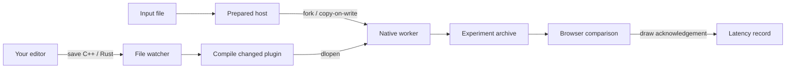

# How Relive keeps the starting point

Relive recompiles a native shared library when a watched source file changes. A single-threaded preparation process keeps parsed input arrays and native geometry in memory. For each experiment it forks a child, loads the new library in that child, runs it, writes the result, and exits. Linux copy-on-write keeps the parent's prepared data intact.

This boundary avoids trying to move live C++ objects or Rust ownership graphs between incompatible libraries. It also keeps a segmentation fault out of the process that owns the prepared data. The worker is a crash boundary, **not a security sandbox**. Use code you trust.

## What survives a code change

| State | Behavior |
| --- | --- |
| Input netlist / original mesh | Immutable, content-addressed, retained in the prepared process |
| Net incidence arrays and connectivity layout | Prepared once and inherited by each worker |
| Mesh matrices and boundary closure | Retained in the native geometry engine |
| Geometry normals and normalized coordinates | Saved in the prepared snapshot |
| Algorithm heap, globals, pointers, random generator | Reset for each run |
| Mesh collapse queue, working mesh, distance evaluation | Rebuilt by libigl each run; included in algorithm/evaluation timing |
| Browser camera, wireframe, reference selection | Retained while editing and rerunning in the open page |
| Source, parameters, result, compiler version | Saved with every experiment |
| Prepared state after restarting the server | Rehydrated from checksummed NumPy arrays |
| Changed input file or adapter implementation | Restart the server to create a new snapshot |
| Changed plugin ABI | Rejected unless ABI version is 1 |
| Changed shared header or mesh engine source | Watched and rebuilt; engine change restarts that prepared host |

Camera state is browser session state, not part of the exported numerical experiment. The UI does not restore an arbitrary suspended stack frame or continue an algorithm halfway through a function. Branches share a **prepared starting point**, not a paused instruction pointer.

## Native boundary

`native/abi.h` describes borrowed flat buffers. The host owns all inputs and outputs. A plugin cannot return an allocation to another allocator. The netlist plugin exports `relive_abi()` and `partition()`. Mesh criteria export `relive_abi()` and `edge_cost()`. C++ and Rust use the same C calling convention.

The lightweight mesh criterion is compiled separately from the libigl engine. Changing its arithmetic only rebuilds that translation unit. Editing `native/mesh_engine.cpp` rebuilds the engine. The engine protects vertices on open boundaries, contracts valid interior edges, removes temporary infinite faces, and computes directed input-vertex-to-output-surface distances.

The reference algorithm is deliberately editable: balanced greedy local refinement for the hypergraph and a length / dihedral-bend cost for mesh edges. It is not a replacement for Mt-KaHyPar's multilevel partitioner or a claim of optimal mesh quality. A larger feature bias can worsen geometric error. The comparison exists to make that tradeoff visible.

## Experiments and branches

Each `.relive/runs/<id>/` contains the exact plugin source, the ABI header, compiled binary, compiler log, parameters, metrics, output and hashes. Mesh runs also retain the engine binary and engine source. The prepared directory contains the raw input and the prepared arrays. `assets/manifest.json` records upstream sources and licenses.

**Branch from here** selects the experiment's snapshot and parameters as the next starting point. It keeps your current working source. **Restore code** additionally restores the selected source, first backing up the current working file to `.relive/working-backups/`. **Replay** recompiles the archived plugin source without editing the working file. **Export experiment** packages the source, parameters, data and results as a zip.

Replay is deterministic on the tested Linux toolchains. The same Rust and C++ mesh cost produces identical geometry in the tests. Compiler/library/platform changes can change floating-point outcomes. Exported native binaries are for the recorded Linux architecture; rebuilding the plugin requires its compiler. The exported mesh engine is pinned by hash and is reused on replay. Cross-platform binary portability and arbitrary third-party dependency capture are outside this prototype's scope.

## Resource limits

Builds and experiments run through one serial executor. The runtime retains at most one prepared process per dataset, and branches with the same snapshot reuse it. A worker gets a 768 MiB virtual-address-space limit and a 30-second wall-clock alarm. Compilers get 1536 MiB and 120 CPU seconds. libigl, BLAS and OpenMP run serially. Override `RELIVE_WORKER_MEMORY_MB`, `RELIVE_COMPILER_MEMORY_MB` or `RELIVE_TIMEOUT` for larger inputs.

Those limits are per process, not a limit on the whole desktop or browser. Browser memory and Linux page caches are separate. Initial template compilation is the heaviest one-time step. The supplied compressed inputs avoid running WebAssembly Yosys during normal setup.

## Adding another project

Add an entry to `projects.json` with `source`, `language` (`cpp` or `rust`), `dataset`, default `params`, and optionally `adapter: "your_package:Prepared"`. The native build path is generic. Implement the prepared adapter constructor `(dataset, state_dir, engine, fresh, snapshot)` and expose:

- `id`: immutable prepared-state identity.
- `meta`: JSON metadata, including data/adapter hashes.
- `view()`: JSON visualization input.
- `run(library_path, params)`: native execution returning JSON, including `metrics`.

The supervisor, compiler, watcher, crash handling and run archives are reusable. A new domain supplies its preparation/serialization logic, parameter validation, native entry point and browser view. The two included views are specialized; there is no universal geometry viewer for arbitrary outputs.

## Existing work considered

- [cr.h](https://github.com/fungos/cr): in-process C hot reload and static-state transfer. Relive uses process replacement so incompatible native object layouts do not need migration.
- [Rust libloading](https://docs.rs/libloading/latest/libloading/): a common dynamic-loading building block. Relive uses Python's ctypes at the process boundary and does not share Rust-owned objects.
- [libigl decimation](https://libigl.github.io/tutorial/#mesh-decimation): supplies the tested edge-collapse machinery and distance queries.
- [Mt-KaHyPar](https://github.com/kahypar/mt-kahypar): a research reference for hypergraph objectives and stronger partitioning algorithms. It is not executed or benchmarked by the bundled demo.
